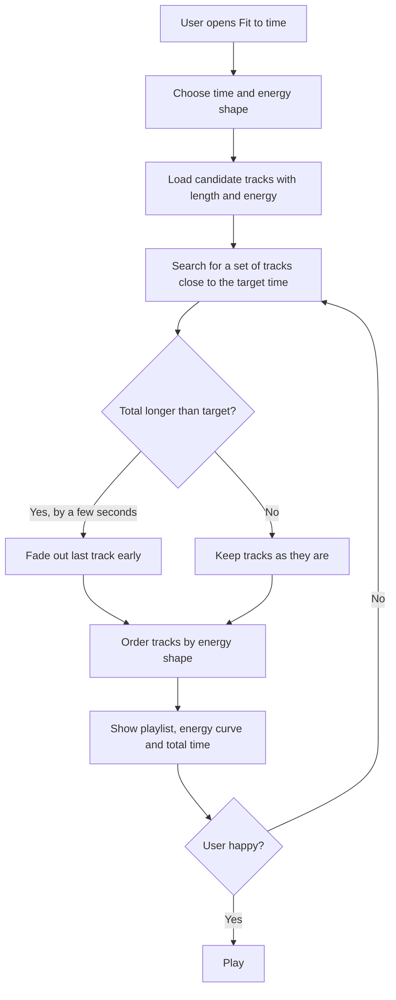

# Fit to Time: a proposed Spotify feature

**Live prototype:** https://YOUR-USERNAME.github.io/fit-to-time/

## 1. Product and problem

**Product:** Spotify, the music streaming app.

**Problem:** People often listen with a fixed amount of time in mind: a 25-minute study round, a 40-minute commute, a 30-minute workout. Spotify playlists have no idea about that. The music ends at a random point, or keeps going past the moment you needed it to stop, so you have to watch the clock or be interrupted by silence or a random next song. The energy of the music also does not match the activity: a workout needs rising energy, and a wind-down before sleep needs falling energy.

## 2. Proposed solution

**Fit to time** lets you enter how long you have, and Spotify builds a playlist of that exact length.

1. The user picks a purpose (study, commute, workout) or sets minutes with a slider.
2. The user picks an energy shape: **Build up**, **Wind down** or **Steady**.
3. Spotify picks tracks from the user's liked songs or a chosen playlist so that the total length matches the target.
4. If the total overshoots by a few seconds, the last track fades out early so the playlist ends exactly on time.
5. The user sees the energy curve, the track list and the total time, and can tap **Try another mix**.

## 3. Visual representation

### Wireframe

```
+----------------------------------+      +----------------------------------+
|  Fit to time                     |      |  Your mix          25:00 / 25:00 |
|                                  |      |                                  |
|  What are you doing?             |      |  Energy   ..:::|||||####         |
|  (Study) (Commute) (Workout)     |      |                                  |
|                                  |      |  Fades out 14s early to end      |
|  Time:  [====o-------]  25 min   |      |  exactly on time.                |
|                                  |      |                                  |
|  Energy:  (Build) (Wind) (Steady)|      |  1  Soft Reset         3:16      |
|                                  |      |  2  Warm Signal        2:48      |
|  [ Make my playlist ]            |      |  3  Chalk Marks        3:28      |
+----------------------------------+      |  [ Try another mix ]             |
          Screen 1: Setup                 +----------------------------------+
                                                    Screen 2: Result
```

### Flowchart



## 4. Implementation approach

- **Data needed:** each track's length and an energy score. Spotify's own audio features already include energy, so a real version would not need new data.
- **Core algorithm:** this is a subset-sum problem. A dynamic programming table over seconds finds which sets of tracks add up to a total close to the target (up to 45 seconds over). The tracks are shuffled before each search so "Try another mix" gives a different result.
- **Ordering:** the chosen tracks are sorted by energy (ascending, descending), or shuffled within a mid-energy band for Steady.
- **Exact finish:** if the total overshoots, the last track gets a fade-out so playback ends at the target time.
- **Tools for a real version:** React for the UI, the Spotify Web API for the user's library and audio features, and a small Node.js service for the playlist search. Spotify's own services would run this server-side at scale.
- **Prototype stack:** HTML, CSS and vanilla JavaScript (frontend only).

## 5. Working prototype

Open `index.html`. It uses a sample library of 36 made-up tracks, so no Spotify login is needed. Try the Study round preset with Build up, then press **Try another mix** a few times.

**Setup:** download the files and open `index.html` in a browser. To publish, enable GitHub Pages under Settings > Pages (branch `main`, folder `/ (root)`).

## Limitations and next steps

- The prototype does not play audio and uses fake tracks.
- A real version would respect the user's taste, skip tracks they dislike and avoid repeating songs from the last mix.
- Smoother energy curves could come from picking tracks in order rather than sorting a chosen set.
